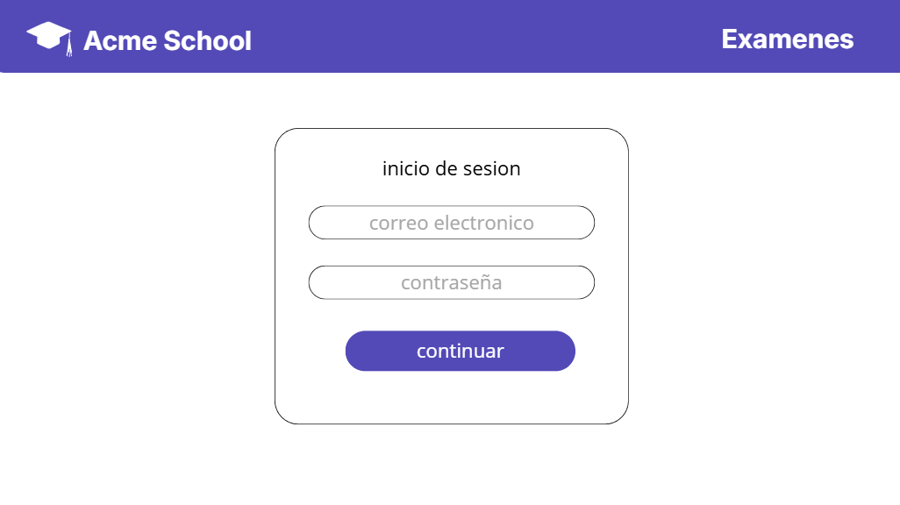
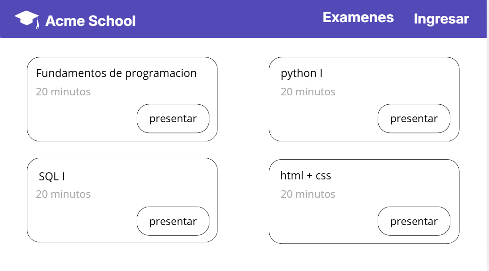
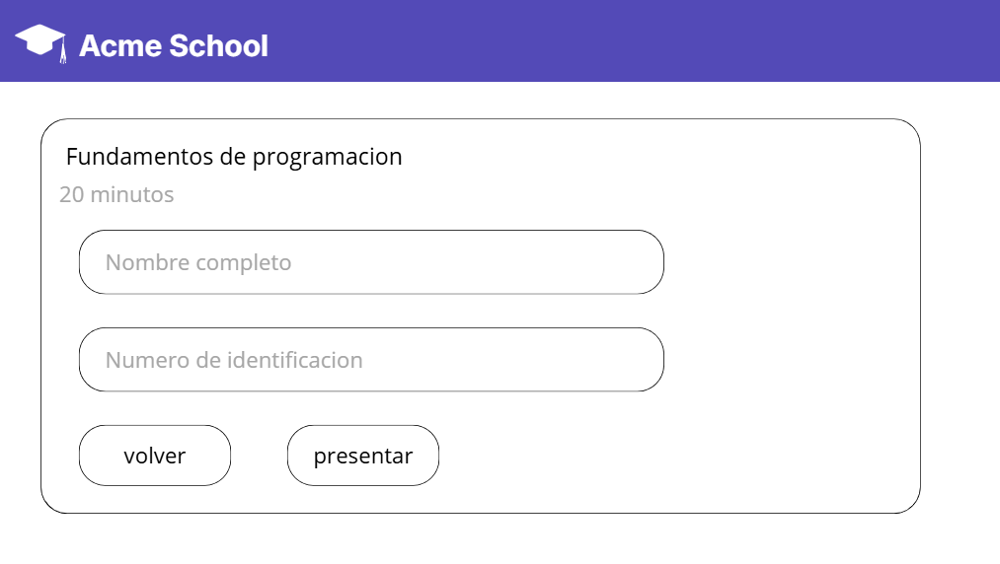
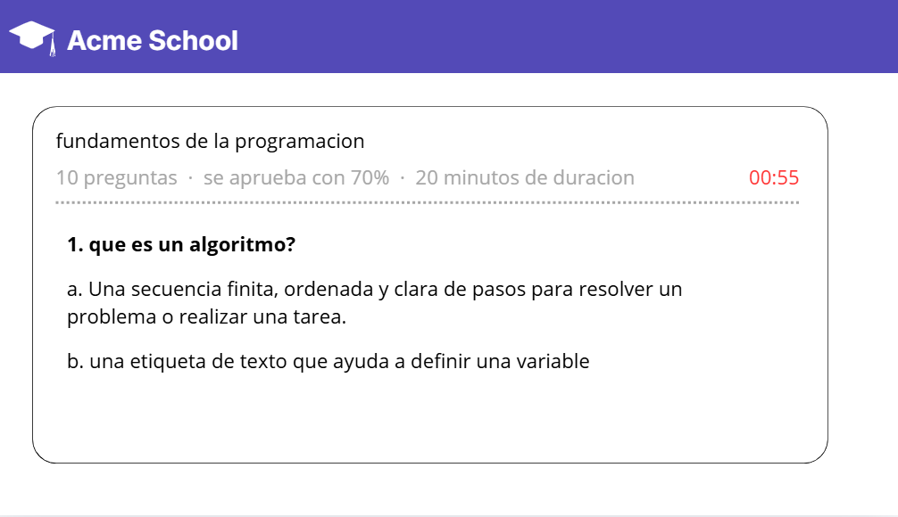
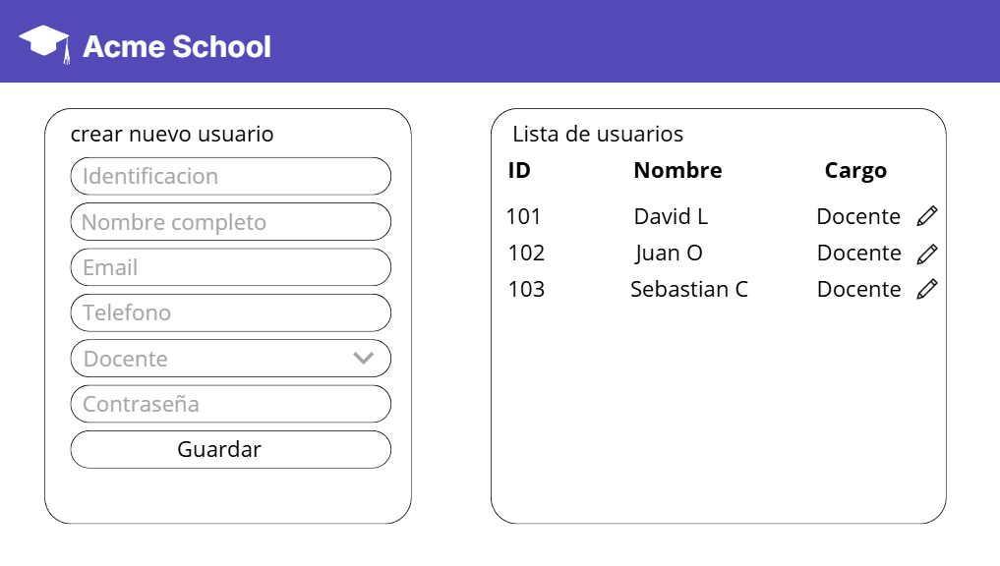
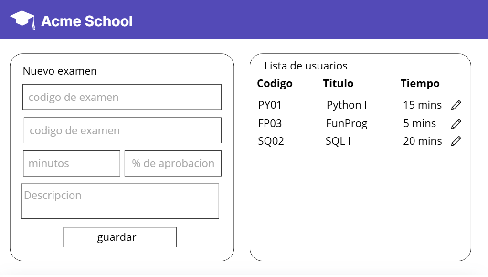
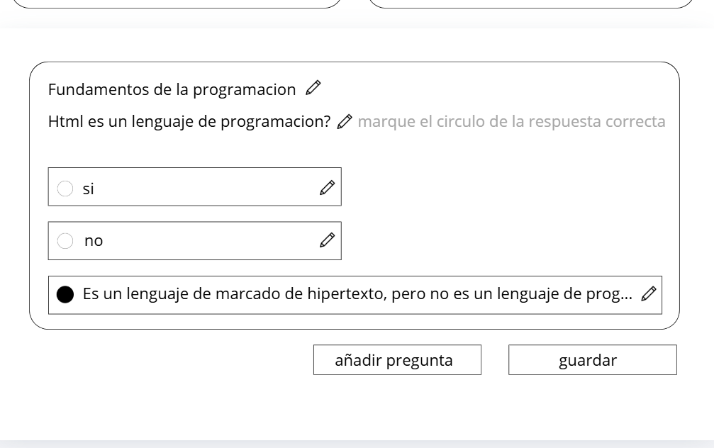

# Plataforma de exámenes – Acme School

Aplicación web para que la escuela Acme cree exámenes y sus estudiantes los presenten en línea.
Desarrollada con **HTML, CSS y JavaScript puro**, usando **Web Components** y **localStorage** para guardar los datos.

## Cómo ejecutarla

1. Clonar el repositorio.
2. Abrir la carpeta en VS Code.
3. Abrir `index.html` con la extensión **Live Server** (clic derecho → *Open with Live Server*).

### Usuario administrador por defecto

La primera vez que se abre la app se crea este usuario para poder ingresar:

| Correo | Contraseña |
|---|---|
| admin@acme.edu | admin123 |

## Módulos

### Públicos (sin iniciar sesión)
- **Inicio:** lista de exámenes disponibles con título, tiempo, porcentaje de aprobación y número de preguntas.
- **Presentar examen:** el estudiante ingresa su identificación y nombre completo, responde las preguntas con un reloj que cuenta el tiempo en tiempo real y puede terminar antes con el botón *Terminar*. Si el tiempo llega a 0 o sale del examen, este se entrega automáticamente.
- **Resultado:** muestra el porcentaje de respuestas correctas y si aprobó o no según el porcentaje configurado.

### Privados (requieren iniciar sesión)
- **Login:** ingreso con correo y contraseña.
- **Gestión de usuarios:** crear, editar y eliminar usuarios (identificación, nombre, email, teléfono, cargo y contraseña).
- **Gestión de exámenes:** crear, editar y eliminar exámenes (código, título, tiempo, porcentaje de aprobación y descripción), y administrar sus preguntas con varias respuestas, de las cuales solo una puede ser la correcta.
- **Resultados:** consulta de los exámenes presentados, con filtro por examen y el detalle de las respuestas de cada estudiante.

## Estructura del proyecto

```
├── index.html
├── README.md
├── capturas/
│   └── mockups/   
├── css/
│   └── styles.css              → estilos, colores y animaciones
└── js/
    ├── storage.js              → funciones para leer y guardar en localStorage (CRUD genérico)
    ├── auth.js                 → inicio y cierre de sesión
    ├── app.js                  → navegación entre vistas y protección de rutas privadas
    ├── componentes/
    │   ├── editor-preguntas.js → Web Component <editor-preguntas>
    │   └── reloj-examen.js     → Web Component <reloj-examen>
    └── vistas/
        ├── usuarios.js         → gestión de usuarios
        ├── examenes.js         → gestión de exámenes
        ├── publico.js          → lista, presentación y resultado del examen
        └── resultados.js       → resultados de los estudiantes
```

## Estructura de los datos (localStorage)

**users**
```json
{ "id": "101", "nombre": "Ana Pérez", "email": "ana@acme.edu", "telefono": "3001234567", "cargo": "docente", "password": "1234" }
```

**exams**
```json
{
  "codigo": "MAT01", "titulo": "Matemáticas", "tiempo": 10, "aprobacion": 60, "descripcion": "Operaciones básicas",
  "preguntas": [
    { "id": 1732400000000, "texto": "¿Cuánto es 2 + 2?",
      "respuestas": [ { "descripcion": "3", "correcta": false }, { "descripcion": "4", "correcta": true } ] }
  ]
}
```

**results**
```json
{ "codigoExamen": "MAT01", "tituloExamen": "Matemáticas", "idEstudiante": "2002", "nombreEstudiante": "Luis Gómez",
  "respuestas": { "1732400000000": 1 }, "correctas": 1, "total": 1, "porcentaje": 100,
  "aprobacion": 60, "aprobado": true, "fecha": "2026-11-23T18:00:00.000Z" }
```

La sesión del usuario se guarda en **sessionStorage**, por lo que se cierra al cerrar la pestaña.

## Web Components

- **`<editor-preguntas codigo="...">`**: permite agregar y eliminar las preguntas de un examen. Valida que cada pregunta tenga al menos 2 respuestas y una sola correcta. Avisa a la vista con el evento `preguntas-cambiaron`.
- **`<reloj-examen minutos="...">`**: cuenta regresiva del examen. Calcula el tiempo según la hora de finalización, para que siga siendo exacto aunque se cambie de pestaña. Cambia a rojo en el último minuto y emite el evento `tiempo-agotado` al llegar a 0.

### Reglas y validaciones
- Cada estudiante puede presentar un mismo examen **una sola vez** (se valida con su número de identificación).
- El número de identificación solo acepta números (entre 6 y 10 dígitos).
- No se permiten usuarios con la misma identificación o el mismo email, ni exámenes con el mismo código.
- La identificación de un usuario y el código de un examen no se pueden modificar, porque son los que identifican cada registro.
- Al eliminar un examen se eliminan también sus preguntas y los resultados de los estudiantes.
- Un usuario no puede eliminarse a sí mismo mientras tiene la sesión iniciada.
- Solo se muestran en el inicio los exámenes que tienen al menos una pregunta.

## Diseño

- Paleta de colores definida con variables CSS (`--color-principal`, `--color-exito`, `--color-error`, etc.).
- Diseño responsive con CSS Grid, Flexbox y media queries.
- Animaciones y transiciones en tarjetas, botones, editor de preguntas, reloj y resultado.

## Mockups

Diseño inicial de las vistas, hecho en Canva antes de programar. La versión final
incluye mejoras que surgieron durante el desarrollo (botones de eliminar, menú en las
vistas privadas, botón *Terminar* y vista de resultados).

### Login


### Inicio: exámenes disponibles


### Datos del estudiante


### Presentar examen


### Gestión de usuarios


### Gestión de exámenes


### Editor de preguntas


## Autor

David Ricardo López